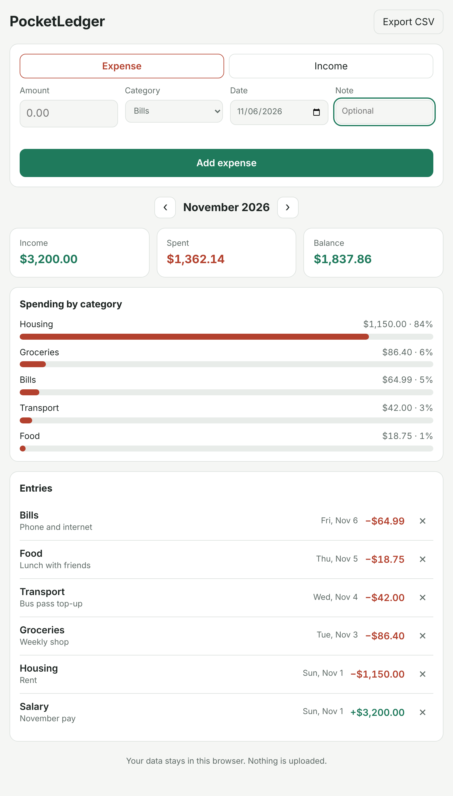

# PocketLedger

[](https://github.com/zeexduaa/pocketledger/actions/workflows/ci.yml)

[](LICENSE)

**A private, offline personal finance tracker that runs in your browser.**

Log what you spend and earn, see where your money went each month, and export it all to a spreadsheet. There are no accounts, no servers and no tracking: your entries are saved in your own browser and never leave your device.

- **Who it's for:** anyone who wants a quick, simple way to keep track of their own spending without signing up for a banking app.
- **Built with:** TypeScript (strict), Vite, plain DOM (no framework), localStorage, Node's built-in test runner, GitHub Actions CI.

> Status: **early (v0.1)**. See the [roadmap](ROADMAP.md) for what's planned.



## Features

- Add expenses and income with amount, category, date and an optional note
- Amounts typed the way people type them: `12.5`, `$1,250.00`, `12,50`
- Month-by-month view with income, spending and balance
- Spending by category, as bars with percentages
- Delete entries, with a few seconds to undo
- Remembers the category you used last
- Export everything to CSV (opens in Excel, Google Sheets, LibreOffice)
- Works on phones and in dark mode
- Money is stored as whole cents, so totals are always exact

## Run it

You need [Node.js](https://nodejs.org/) 22 or newer.

```
git clone https://github.com/zeexduaa/pocketledger.git
cd pocketledger
npm install
npm run dev
```

Then open the link it prints (usually http://localhost:5173).

| Command             | What it does                                    |
|---------------------|-------------------------------------------------|
| `npm run dev`       | Start the app with live reload                  |
| `npm test`          | Run the unit tests                              |
| `npm run typecheck` | Type-check the app and the tests                |
| `npm run build`     | Type-check, then build a static site in `dist/` |

The built `dist/` folder is a plain static site, so it can be hosted anywhere (GitHub Pages, Netlify, a USB stick).

## How it's organised

```
src/
  money.ts     parsing and formatting amounts, in cents
  ledger.ts    transactions, validation, monthly summaries
  storage.ts   saving to and loading from localStorage
  csv.ts       CSV export
  dom.ts       small helpers for building the page safely
  main.ts      the app screen
  *.test.ts    tests (node --test)
```

Everything except `main.ts` and `dom.ts` is plain logic with no browser dependency, so it's tested directly in Node.

## Privacy

PocketLedger makes no network requests. Your data lives in your browser's localStorage for this site, so clearing your browser data deletes it. Export a CSV now and then if you want a backup.

## Contributing

Bug reports and ideas are welcome in the [issues](https://github.com/zeexduaa/pocketledger/issues).

## License

[MIT](LICENSE) © 2026 Syed Ali
